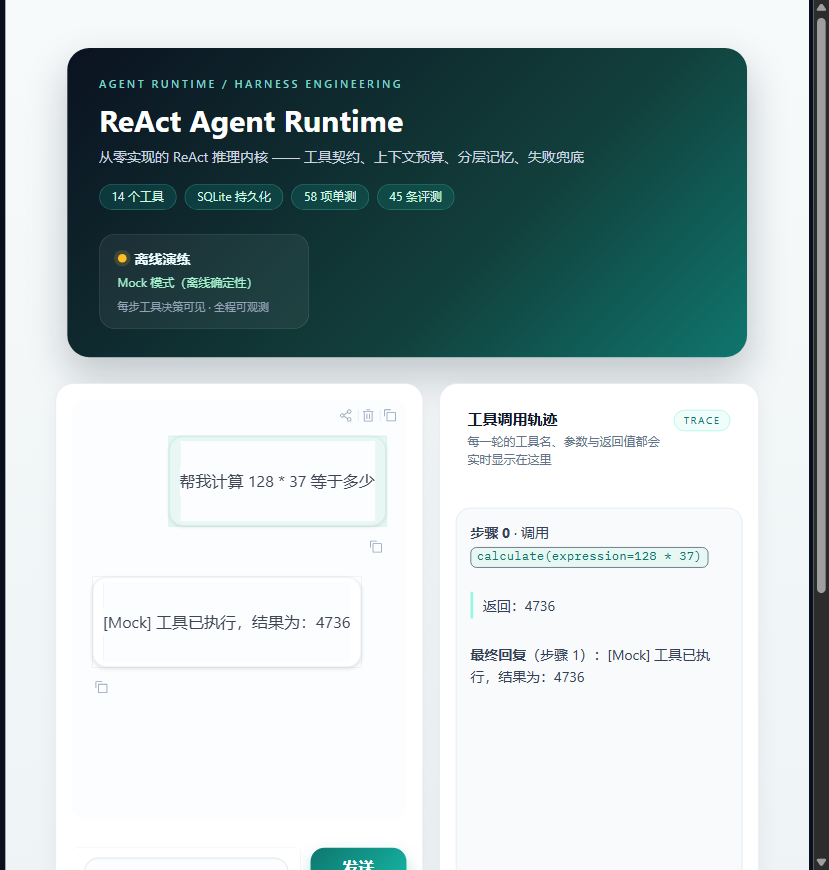

# ReAct Agent Runtime

> 从零实现的 ReAct 推理内核 + 工具契约 + 上下文预算 + 分层记忆 + 检索增强 + 失败兜底。
> **不依赖 LangChain / LangGraph**：循环、工具调度、记忆、检索、评测、可观测全部自研。
> 关键证据：**58 项单元测试**、**45 条评测集四指标全绿**、每次运行产出结构化轨迹日志。

这个项目的目标不是"做一个能聊天的应用"，而是把 Agent 从"能跑通"推到 **可约束、可评测、可观测**：
每一步模型决策都能被检查，每一个危险动作都有闸门，每一次失败都有兜底路径。

---

## 运行界面



> 右侧轨迹面板逐轮展示工具名、参数与返回值，用于检查模型每一步为什么这么走；顶部状态条区分在线模型与离线确定性模式。
> 截图里可见的每个工具调用，都对应下文某一条工程约束。

## 工程约束一览

| 约束 | 实现 | 防止什么 |
|---|---|---|
| **循环本体** | `agent/core.py`：ReAct 主循环，三出口（自然结束 / 强制结束 / 异常结束），最多 5 轮 | 模型无限打转、任务永不收敛 |
| **工具契约** | `@tool` 装饰器自动推断 Schema，注册表自动扫描，14 工具零装配接入 | 新增工具改动内核、Schema 与实现不一致 |
| **参数护栏** | Pydantic `params_model` 执行前校验，脏参数不进真实函数 | 模型编造参数导致工具执行异常 |
| **权限分级** | read / write / danger 三级，danger 无人确认默认拒绝（fail-safe） | 删数据类操作被模型静默执行 |
| **上下文预算** | token 预算 8000 + 窗口收缩 + 工具结果限长 | 上下文无限膨胀、超窗直接报错 |
| **分层记忆** | 短期滑动窗口 + SQLite 长期记忆；被窗口裁掉的旧消息落库 | 长对话"永久遗忘"早期信息 |
| **语义检索** | 历史按相关性召回注入（top_k=5 / 1500 token）；TF 与本地 bge-small-zh 双向量器可切 | 字面匹配召回不到同义问法 |
| **检索增强** | 自研 RAG：白名单摄入 → 段落切块 → 向量化 → 余弦 top-k → 回答带出处 | 回答无依据、无法溯源 |
| **失败兜底** | 异常分层体系 + 指数退避重试 + 超窗自动收缩 + 循环保险丝 + 单轮超时 | 网络抖动、坏 JSON、超窗直接崩溃 |
| **可观测** | 每次 run 输出 stats 体检报告 + `logs/agent.jsonl` 逐步事件 | 黑盒运行、问题无法定位 |
| **评测闭环** | 45 条用例四指标（工具 / 参数 / 回答 / 综合）+ 58 项单元测试 | 改动后靠"感觉没问题"上线 |

## 五层架构（Prompt → Context → Harness → Loop → Graph，叠加而非替代）

| 层 | 这一层解决什么 | 本项目实现 |
|---|---|---|
| **L1 Prompt** | 引导模型行为与输出格式（软约束） | `Agent._system_prompt`，工具使用策略注入 |
| **L2 Context** | 控制"模型能看到什么"：预算 + 压缩 + 检索 | `agent/memory.py`：token 预算（8000）、窗口收缩、历史检索注入（top_k=5 / 1500 token） |
| **L3 Harness** | 模型与世界的安全边界：工具契约、参数、权限 | `agent/tools.py`：schema 推断、`params_model` 校验、三级分级 + 人工确认 |
| **L4 Loop** | 观察→决策→行动的循环本体与终止保障 | `agent/core.py`：ReAct 主循环、三出口、保险丝、超时 |
| **L5 Graph** | 把循环显式化为图（分支/并行/断点） | 当前单循环场景不需要；概念上对齐 LangGraph 的状态编排，手写循环即最小图版 |

> 设计主线：**五层逐层加固，每一层都不替代上一层**。完整演进见 [docs/03-生产级改造.md](docs/03-生产级改造.md)。

## 可靠性改造记录（8 次提交）

| 提交 | 改造 | 解决的问题 |
|---|---|---|
| `422c372` | **P0 会话历史向量检索** | 窗口裁掉旧消息=永久遗忘 → 落库 + 相关性召回注入 |
| `19534ef` | **P1 token 预算** | 上下文无限膨胀 → 估算精确化 + 窗口按预算收缩 + 工具结果限长 |
| `4b8fa24` | **P2 Embedding 语义检索** | TF 字面匹配同义召回失败 → 本地 bge-small-zh 语义向量化 |
| `46d87b9` | **参数护栏** | 模型可能传脏参数 → 执行前 Pydantic 校验，不进真实函数 |
| `5b2e31d` | **工具分级 + 人工确认** | 危险操作无闸门 → read/write/danger 三级，fail-safe |
| `99d15d6` | **循环保险丝** | 模型可能死循环烧钱 → 重复调用检测 + 单轮超时 |
| `a1f0ba6` | **LLM 错误处理** | 网络抖动 / 超窗 / 坏 JSON 崩溃 → 异常分层 + 重试 + 兜底 + 超窗收缩 |
| `6e1d1f9` | **可观测性** | 黑盒运行 → stats 体检报告 + 结构化 JSONL 日志 |

## 技术栈

| 层 | 技术 |
|---|---|
| 语言 | Python 3.13 |
| LLM | OpenAI 兼容接口（openai SDK），内置规则式 MockLLM（离线确定性评测） |
| 存储 | SQLite（标准库，零依赖） |
| 检索 | 自研 TF 向量（零依赖）+ 本地 **bge-small-zh-v1.5** Embedding（sentence-transformers） |
| 护栏 | Pydantic v2（`@tool params_model`） |
| 界面 | Gradio |
| 测试 / 评测 | pytest（58 项）+ 自研评测脚本（45 条四指标） |

## 目录结构

```
Agent/
├── agent/                  # Agent 内核
│   ├── core.py             #   ReAct 主循环（检索注入/预算/护栏/分级/保险丝/LLM兜底/stats收口）
│   ├── llm.py              #   LLM 封装（OpenAILLM 重试+超窗 / MockLLM / 本地异常体系）
│   ├── tools.py            #   @tool 装饰器 + ToolRegistry（schema 推断/params_model/level）
│   ├── memory.py           #   会话记忆（滑动窗口 + token 预算收缩）
│   ├── history_memory.py   #   历史落库 + 向量检索（TfVectorizer / EmbeddingVectorizer）
│   ├── observability.py    #   可观测性（AgentStats + JsonlLogger 结构化日志）
│   └── factory.py          #   配置加载与 Agent 装配（vectorizer 开关）
├── tools/                  # 14 个工具（自动扫描注册，零装配）
│   ├── data_store.py       #   SQLite 公共存储（四表，幂等建表）
│   └── *_tool.py           #   时间/计算/骰子/待办/笔记/记忆/天气/知识检索/RAG 检索…
├── rag/                    # 自研 RAG 模块（摄入/切块/向量化/检索）
├── ui/app.py               # Gradio 运行界面（工具轨迹可视化）
├── eval/                   # 评测：test_suite.json(45 条) + run_eval.py → output/report.md
├── tests/                  # 单元测试（58 项，覆盖内核/工具/记忆/错误处理/可观测性）
├── config/config.yaml      # LLM 与记忆配置（provider: mock | openai；vectorizer: tf | embedding）
├── models/                 # 本地 bge-small-zh-v1.5 权重（~95MB，不入库）
├── logs/                   # 可观测日志 agent.jsonl（运行时生成，不入库）
└── docs/                   # 需求与架构 / 生产级改造演进
```

## 快速开始

```powershell
# 1. 创建虚拟环境并安装依赖（一次性）
python -m venv .venv
.\.venv\Scripts\python.exe -m pip install -r requirements.txt

# 2. 启动运行界面（默认 http://127.0.0.1:7860）
.\.venv\Scripts\python.exe ui\app.py

# 3. 测试与评测
.\.venv\Scripts\python.exe -m pytest tests -q        # 58 项
.\.venv\Scripts\python.exe eval\run_eval.py          # 45 条 → eval/output/report.md
```

**接入真实模型**：复制 `config/config.yaml` 为 `config/secret.yaml`，填 `base_url / api_key / model`，
把 `provider` 改为 `openai`（secret.yaml 优先级覆盖且不入库）。删除 secret.yaml 即回到离线 Mock 模式。

**启用语义检索（可选）**：`config/config.yaml` 的 `memory.vectorizer: embedding` 需要本地模型
`models/bge-small-zh-v1.5`（缺失时自动回退 TF）。

## 能力验证矩阵

工具本身只是**验证载体**——重点不在功能，而在每条输入都能对应一个被工程化约束的能力：

| 输入 | 触发 | 验证的工程点 |
|---|---|---|
| `帮我计算 128 * 37` | 计算工具 | Pydantic 参数校验，安全求值（结果 4736） |
| `掷一个 6 面的骰子` | 骰子工具 | 边界约束示范：`faces ∈ [2,100]` |
| `记一下明天上午 10 点开周会` | 待办工具 | SQLite 持久化（write 级权限） |
| `删掉编号 3 的待办` | 删除工具 | danger 级：无人工确认默认拒绝 |
| `芜湖今天天气怎么样` | 天气工具 | 外部 API 调用与失败兜底 |
| `什么是 RAG？` | 知识检索工具 | 知识注入与结构化回答 |
| `高普视觉检测系统的总体架构是什么？` | RAG 检索 | 检索增强 + 回答带出处 |
| `记住我周末常去健身` | 长期记忆 | 跨会话持久化 |
| `我之前说过什么` | 记忆召回 | 被裁消息落库 + Embedding 语义召回 |

## 一次请求的完整链路（30 秒版）

```
用户输入
  → 组装上下文（System + 历史检索注入 + 窗口 + 当前输入，受 token 预算约束）
  → LLM（携带 14 个工具的 JSON Schema）
  → 模型返回结构化 tool_calls（工具名 + 参数）
  → 注册表查找 → 参数校验（Pydantic）→ 分级闸门（danger 需人工确认）
  → 执行工具（单轮超时保护）→ 结果回填为 observation
  → 循环（最多 5 轮；保险丝防死循环）直到模型不再调用工具 → 输出最终回复
  → 全程统计 stats + 写结构化日志（logs/agent.jsonl）
```

## 演进路线

需求分析 → 架构设计 → 内核实现 → 工具与记忆 → 运行界面 → 评测迭代 →
可靠性改造 → 可观测性 → 文档沉淀。
八次可靠性改造的完整记录见 [docs/03-生产级改造.md](docs/03-生产级改造.md)。

## 开发进度

- [x] P0 环境与项目初始化
- [x] P1 需求与架构设计
- [x] P2 内核实现（ReAct 循环 / LLM 封装 / 工具注册）
- [x] P3 工具与记忆系统（14 工具 / SQLite 持久化 / 长期记忆）
- [x] P4 运行界面（Gradio + 轨迹可视化）
- [x] P5 评测与迭代（45 条用例四指标 100%）
- [x] P6 文档整理
- [x] R8 自研 RAG 模块（摄入/切块/向量化/检索 + 真实项目知识库）
- [x] **G1 会话历史向量检索**：被裁旧消息落库 + 相关性召回（422c372）
- [x] **G2 token 预算**：估算精确化 + 窗口收缩 + 工具结果限长（19534ef）
- [x] **G3 Embedding 语义检索**：本地 bge-small-zh + 配置开关（4b8fa24）
- [x] **G4 参数护栏**：Pydantic 校验，脏参数不进真实函数（46d87b9）
- [x] **G5 工具分级 + 人工确认**：read/write/danger，fail-safe（5b2e31d）
- [x] **G6 循环终止机制**：重复调用检测 + 单轮超时（99d15d6）
- [x] **G7 LLM 错误处理层**：异常体系 + 重试 + 超窗收缩 + 兜底（a1f0ba6）
- [x] **G8 可观测性**：stats + 结构化日志（6e1d1f9）
