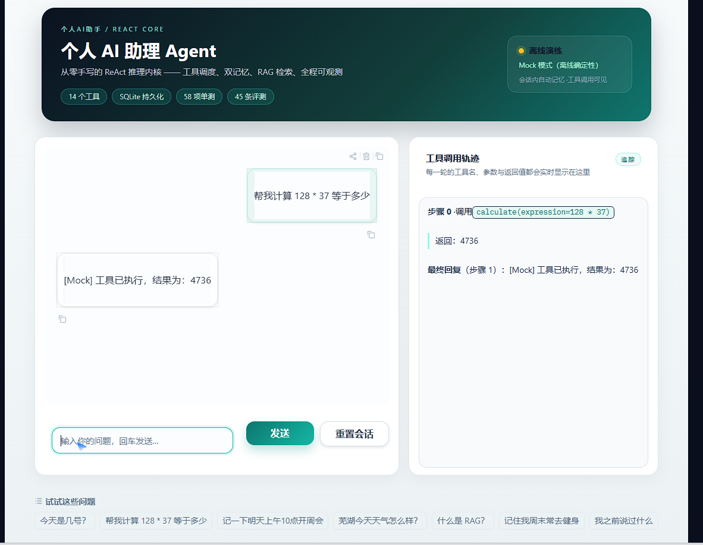

# 个人 AI 助理 Agent（Personal AI Assistant Agent）

> 从零手写 ReAct 内核 + Function Calling + 双记忆 + 自研 RAG + **生产级可靠性改造**的通用 AI 助理。
> 不依赖任何现成 Agent 框架（无 LangChain / LangGraph），核心循环、工具调度、记忆、检索、评测全部自研。
> 可运行、可评测、可观测。

---

## 界面预览



> 左侧对话区渲染回答，右侧同步展示每一轮的工具名、参数与返回值；顶部状态卡显示当前运行模式（真实模型 / Mock 离线演练）。

## 特性一览

- **手写 Agent 内核**：ReAct 推理循环 + 原生 Function Calling 工具调度，无 LangChain/LangGraph 依赖
- **热插拔工具机制**：`@tool` 装饰器 + 注册表自动扫描，新增工具零侵入内核（当前 **14 个工具**）
- **双记忆系统**：会话记忆（滑动窗口 + token 预算收缩）+ 长期记忆（SQLite 跨会话持久化）
- **会话历史语义检索**：被窗口裁掉的旧消息落库，按相关性注入上下文；TF / **本地 bge-small-zh Embedding** 双向量器可切换
- **自研 RAG**：本地文档白名单摄入 → 段落切块 → TF-IDF 向量化 → 余弦检索 top-k → 回答带出处
- **LLM 错误处理层**：本地异常体系 + 指数退避重试 + 上下文超窗自动收缩重试 + 非法 JSON 不再静默吞错
- **Harness 安全治理**：Pydantic 参数护栏 · 工具 read/write/danger 三级 · danger 无人确认默认拒绝 · 循环保险丝 · 工具单轮超时
- **可观测性**：每次 run 输出 stats 体检报告 + `logs/agent.jsonl` 结构化日志（每步 LLM/工具事件）
- **双运行模式**：真实模型（OpenAI 兼容接口）/ Mock 模式（离线可跑、评测确定性）
- **评测体系**：45 条测试集四指标全绿（工具 100% / 参数 100% / 回答 100% / 综合 100%）

## 五层架构设计（认知主线：Prompt → Context → Harness → Loop → Graph，叠加非替代）

| 层 | 这一层解决什么 | 本项目实现 |
|---|---|---|
| **L1 Prompt** | 引导模型行为与输出格式（软约束） | `Agent._system_prompt`，工具使用策略注入 |
| **L2 Context** | 控制"模型能看到什么"：预算 + 压缩 + 检索 | `agent/memory.py`：token 预算（8000）、窗口收缩、历史检索注入（top_k=5 / 1500 token） |
| **L3 Harness** | 模型与世界的安全边界：工具契约、参数、权限 | `agent/tools.py`：schema 推断、`params_model` 校验、三级分级 + 人工确认 |
| **L4 Loop** | 观察→决策→行动的循环本体与终止保障 | `agent/core.py`：ReAct 主循环、三出口（自然/强制/异常）、保险丝、超时 |
| **L5 Graph** | 把循环显式化为图（分支/并行/断点），本项目当前单循环不需要 | 概念对齐 LangGraph：状态编排框架，单循环场景手写循环即最小图版 |

> 设计主线：**五层逐层叠加，每一层都是对上一层的加固而非替代**。
> 详细演进见 [docs/03-生产级改造.md](docs/03-生产级改造.md)。

## 生产级改造（8 次提交速览）

| 提交 | 改造 | 解决的问题 |
|---|---|---|
| `422c372` | **P0 会话历史向量检索** | 窗口裁掉旧消息=永久遗忘 → 落库 + 相关性召回注入 |
| `19534ef` | **P1 token 预算** | 上下文无限膨胀 → 估算精确化 + 窗口按预算收缩 + 工具结果限长 |
| `4b8fa24` | **P2 Embedding 语义检索** | TF 字面匹配同义召回失败 → 本地 bge-small-zh 语义向量化 |
| `46d87b9` | **参数护栏** | 模型可能传脏参数 → 执行前 Pydantic 校验，不进真实函数 |
| `5b2e31d` | **工具分级+人工确认** | 危险操作无闸门 → read/write/danger 三级，fail-safe |
| `99d15d6` | **循环保险丝** | 模型可能死循环烧钱 → 重复调用检测 + 单轮超时 |
| `a1f0ba6` | **LLM 错误处理** | 网络抖动/超窗/坏 JSON 崩溃 → 异常分层 + 重试 + 兜底 + 超窗收缩 |
| `6e1d1f9` | **可观测性** | 黑盒运行 → stats 体检报告 + 结构化 JSONL 日志 |

## 技术栈

| 层 | 技术 |
|---|---|
| 语言 | Python 3.13 |
| LLM | OpenAI 兼容接口（openai SDK），内置规则式 MockLLM（离线确定性评测） |
| 存储 | SQLite（标准库，零依赖） |
| 检索 | 自研 TF 向量（零依赖） + 本地 **bge-small-zh-v1.5** Embedding（sentence-transformers） |
| 护栏 | Pydantic v2（`@tool params_model`） |
| 界面 | Gradio |
| 测试/评测 | pytest（58 项） + 自研评测脚本（45 条四指标） |

## 目录结构

```
Agent/
├── agent/                  # Agent 内核
│   ├── core.py             #   ReAct 主循环（检索注入/预算/护栏/分级/保险丝/LLM兜底/stats收口）
│   ├── llm.py              #   LLM 封装（OpenAILLM 重试+超窗 / MockLLM / 本地异常体系）
│   ├── tools.py            #   @tool 装饰器 + ToolRegistry（schema 推断/params_model/level）
│   ├── memory.py           #   会话记忆（滑动窗口 + token 预算收缩）
│   ├── history_memory.py   #   历史落库 + 向量检索（TfVectorizer / EmbeddingVectorizer）
│   ├── observability.py    #   可观测性（AgentStats + JsonlLogger 结构化日志）
│   └── factory.py          #   配置加载与 Agent 装配（vectorizer 开关）
├── tools/                  # 14 个工具（自动扫描注册，零装配）
│   ├── data_store.py       #   SQLite 公共存储（四表，幂等建表）
│   └── *_tool.py           #   时间/计算/骰子/待办/笔记/记忆/天气/知识检索/RAG 检索…
├── rag/                    # 自研 RAG 模块（摄入/切块/向量化/检索）
├── ui/app.py               # Gradio 对话界面（工具轨迹可视化）
├── eval/                   # 评测：test_suite.json(45 条) + run_eval.py → output/report.md
├── tests/                  # 单元测试（58 项，覆盖内核/工具/记忆/错误处理/可观测性）
├── config/config.yaml      # LLM 与记忆配置（provider: mock | openai；vectorizer: tf | embedding）
├── models/                 # 本地 bge-small-zh-v1.5 权重（~95MB，不入库）
├── logs/                   # 可观测日志 agent.jsonl（运行时生成，不入库）
└── docs/                   # 需求与架构 / 生产级改造演进
```

## 快速开始

```powershell
# 1. 创建虚拟环境并安装依赖（一次性）
python -m venv .venv
.\.venv\Scripts\python.exe -m pip install -r requirements.txt

# 2. 启动对话界面（默认 http://127.0.0.1:7860）
.\.venv\Scripts\python.exe ui\app.py

# 3. 运行测试与评测
.\.venv\Scripts\python.exe -m pytest tests -q        # 58 项
.\.venv\Scripts\python.exe eval\run_eval.py          # 45 条 → eval/output/report.md
```

**接入真实模型**：复制 `config/config.yaml` 为 `config/secret.yaml`，填 `base_url / api_key / model`
并把 `provider` 改为 `openai`（secret.yaml 优先级覆盖且不入库）。删除 secret.yaml 即回到离线 Mock 模式。

**启用语义检索（可选）**：`config/config.yaml` 的 `memory.vectorizer: embedding` 需要本地模型
`models/bge-small-zh-v1.5`（缺失时自动回退 TF）。

## 试试这些

```
今天是几号？            → 时间工具
帮我计算 128 * 37       → 计算工具（安全求值，结果 4736）
掷一个 6 面的骰子       → 骰子工具（Pydantic 参数护栏示范：faces∈[2,100]）
记一下明天上午10点开周会 → 待办工具（SQLite 持久化，write 级）
删掉编号 3 的待办       → 删除工具（danger 级：无人工确认默认拒绝）
芜湖今天天气怎么样？      → 天气工具
什么是 RAG？            → 知识检索工具
高普视觉检测系统的总体架构是什么？  → RAG 检索项目文档（带出处）
记住我周末常去健身       → 长期记忆（跨会话）
我之前说过什么           → 记忆召回（跨会话，Embedding 语义检索）
```

## Agent 工作原理（30 秒版）

```
用户输入
  → 组装上下文（System + 历史检索注入 + 窗口 + 当前输入，受 token 预算约束）
  → LLM（携带 14 个工具的 JSON Schema）
  → 模型返回结构化 tool_calls（工具名 + 参数）
  → 注册表查找 → 参数校验（Pydantic）→ 分级闸门（danger 需人工确认）
  → 执行工具（单轮超时保护）→ 结果回填为 observation
  → 循环（最多 5 轮；保险丝防死循环）直到模型不再调用工具 → 输出最终回复
  → 全程统计 stats + 写结构化日志（logs/agent.jsonl）
```

## 项目演进

一次完整的 Agent 开发闭环：需求分析 → 架构设计 → 内核实现 → 工具与记忆 → 应用落地 →
评测迭代 → 生产级可靠性改造 → 可观测性 → 文档沉淀。
八次生产级改造的完整演进见 [docs/03-生产级改造.md](docs/03-生产级改造.md)。

## 开发进度

- [x] P0 环境与项目初始化
- [x] P1 需求与架构设计
- [x] P2 Agent 内核实现（ReAct 循环 / LLM 封装 / 工具注册）
- [x] P3 工具与记忆系统（14 工具 / SQLite 持久化 / 长期记忆）
- [x] P4 对话界面与演示（Gradio + 轨迹可视化）
- [x] P5 评测与迭代（45 条用例四指标 100%）
- [x] P6 文档整理
- [x] R8 自研 RAG 模块（摄入/切块/TF-IDF/检索 + 真实项目知识库）
- [x] **G1 会话历史向量检索（P0 改造）**：被裁旧消息落库 + 相关性召回（422c372）
- [x] **G2 token 预算（P1 改造）**：估算精确化 + 窗口收缩 + 工具结果限长（19534ef）
- [x] **G3 Embedding 语义检索（P2 改造）**：本地 bge-small-zh + 配置开关（4b8fa24）
- [x] **G4 参数护栏**：Pydantic 校验，脏参数不进真实函数（46d87b9）
- [x] **G5 工具分级 + 人工确认**：read/write/danger，fail-safe（5b2e31d）
- [x] **G6 循环终止机制**：重复调用检测 + 单轮超时（99d15d6）
- [x] **G7 LLM 错误处理层**：异常体系 + 重试 + 超窗收缩 + 兜底（a1f0ba6）
- [x] **G8 可观测性**：stats + 结构化日志（6e1d1f9）
